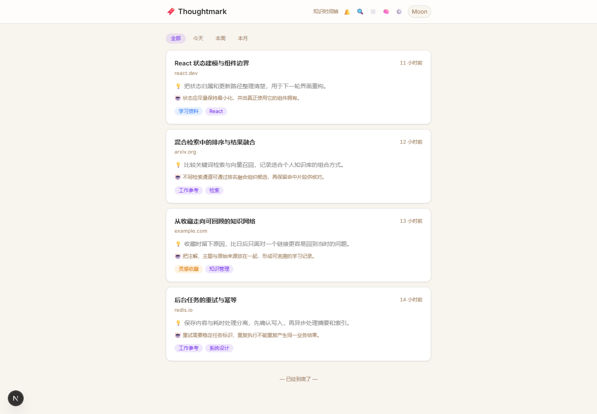
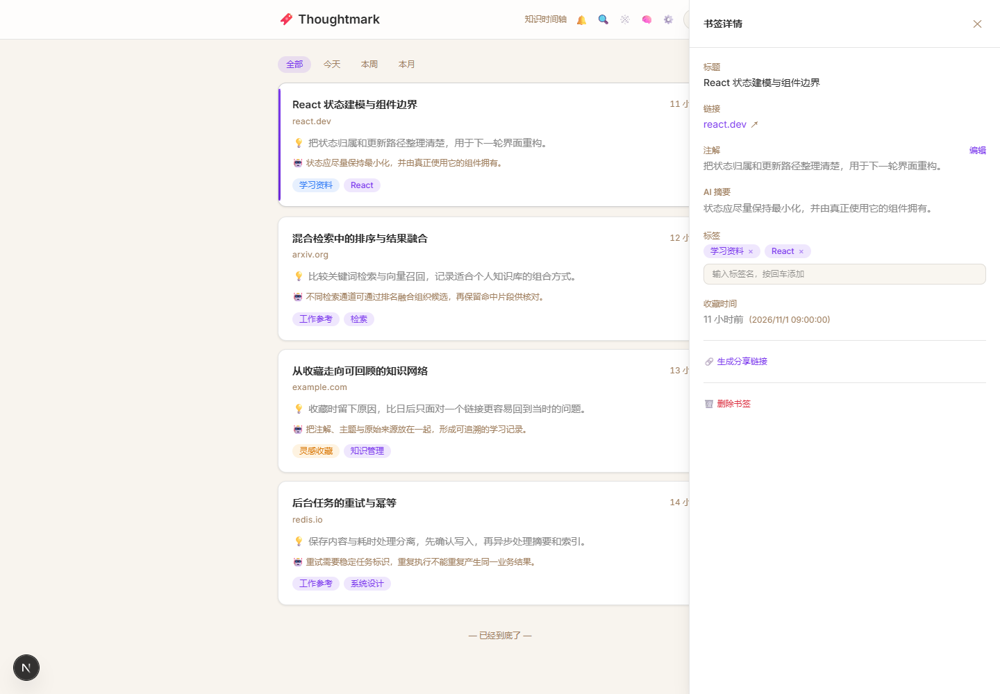
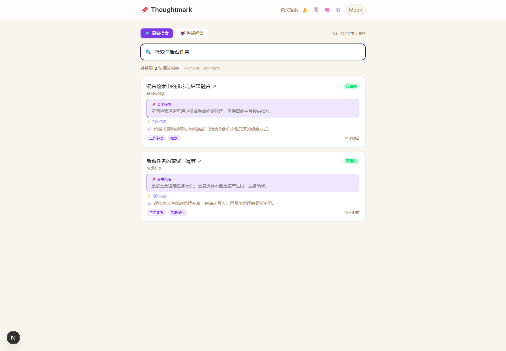
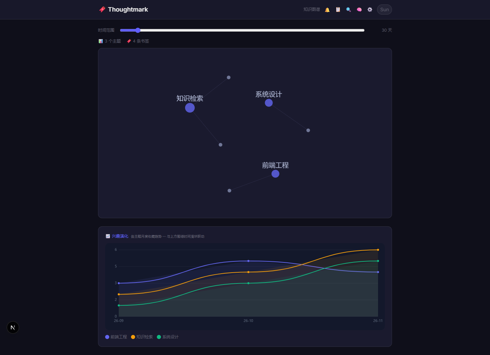
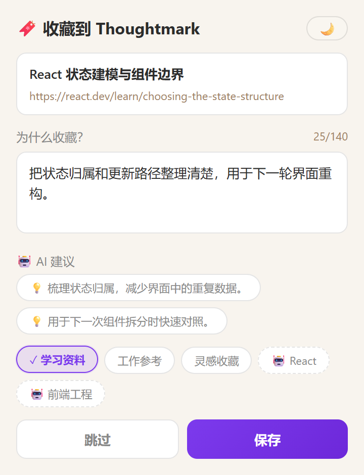

# Thoughtmark

Thoughtmark is a self-initiated portfolio project for turning saved web pages into a searchable personal knowledge base. It combines a Next.js application with a browser extension so users can capture why a page matters, revisit related ideas, and search across saved content.

This repository contains synthetic examples only and is not presented as paid client work. Production credentials, infrastructure addresses, private development notes, and user data are intentionally excluded.

## 项目概览与界面

面向个人学习的书签知识工作台：从浏览器记录网页与收藏原因，在时间轴中回看，通过搜索命中段落、主题与图谱连接相关内容。包含 Next.js 网页应用、WXT 浏览器扩展、PostgreSQL / Prisma 与 Redis / BullMQ 处理代码。

[中文项目说明、技术结构与当前阶段](docs/PROJECT.md)。以下图片来自原网页组件和原扩展构建，使用独立本地固定数据与接口夹具；本次未连接数据库、队列或真实模型，具体操作及验证范围见项目说明。

### 收藏与回看





### 搜索与知识结构





### 浏览器收藏入口



## Why this exists

Bookmarks are easy to collect and hard to revisit. Thoughtmark explores a more
useful capture loop: save the page with context, process it in the background,
connect it to related material, and make it searchable from both the web app and
the browser extension.

## Highlights

- Bookmark capture from a Manifest V3 browser extension
- Authentication, user profiles, and bookmark management
- PostgreSQL persistence through Prisma
- AI-assisted summaries, suggestions, clustering, and retrieval
- Hybrid and semantic search workflows
- Knowledge graph, timeline, notifications, and sharing flows
- Background processing with Redis and BullMQ
- Playwright API and end-to-end test suites

## Technology

- **Web:** Next.js 16, React 19, TypeScript, Tailwind CSS
- **Data:** PostgreSQL, Prisma, pgvector
- **Background jobs:** Redis, BullMQ
- **Authentication:** NextAuth.js
- **Browser extension:** WXT, React, TypeScript, Manifest V3
- **Quality:** ESLint, TypeScript, Playwright, GitHub Actions

## Repository layout

```text
thoughtmark/
├── thoughtmark-web/        # Next.js application, API, workers, and tests
├── thoughtmark-extension/  # Browser extension
└── .github/workflows/      # Continuous integration
```

## Architecture

```text
Manifest V3 extension
        |
        v
Next.js UI and API routes ---> PostgreSQL + pgvector
        |                              |
        v                              v
Redis + BullMQ workers <------ search and graph views
        |
        v
Environment-configured AI and email providers
```

External providers are configuration boundaries rather than bundled services.
The public repository does not include production tokens, private deployment
addresses, or a hosted multi-user environment.

## Run the web application

Requirements: Node.js 22+, PostgreSQL, and Redis.

```bash
cd thoughtmark-web
cp .env.example .env
# Replace every placeholder in .env with local development values.
npm ci
npx prisma generate
npx prisma migrate dev
npm run dev
```

The local application is available at `http://localhost:3000` by default.

## Run the browser extension

```bash
cd thoughtmark-extension
cp .env.example .env
npm ci
npm run dev
```

Set `VITE_API_BASE_URL` to the URL of your local Thoughtmark web application.

## Verification

```bash
cd thoughtmark-web
npx prisma generate
npx tsc --noEmit
npm run lint

cd ../thoughtmark-extension
npm run compile
```

The Playwright suites under `thoughtmark-web/tests/` require the local application and its backing services.

## Security

- Never commit real `.env` files, API keys, passwords, email authorization codes, or deployment addresses.
- The production Compose example resolves all sensitive values from environment variables.
- Use synthetic accounts and `example.com` addresses in scripts and screenshots.

## Need implementation help?

I offer scoped AI/API automation audits, working proofs of concept, integration
implementation, and reliability hardening. Do not include credentials or
sensitive customer data in a public issue.

[Request a scoped project review](https://github.com/gzh246/gzh246/issues/new?template=project-inquiry.yml)

## Project status and license

This is a portfolio-oriented development snapshot, not a hosted production service. No open-source license is currently granted; the source is published for portfolio review and all rights are reserved.
