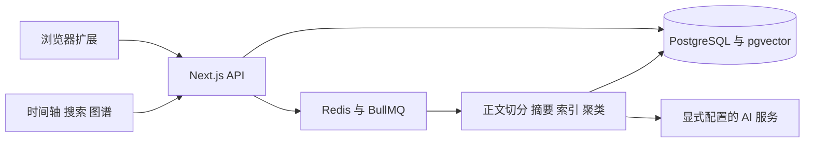

# Thoughtmark 项目说明

Thoughtmark 面向“收藏了很多网页，却忘记为什么收藏、后来也找不到”的个人学习场景。浏览器扩展记录网页、收藏原因和标签，网页工作台通过时间轴、搜索、主题和图谱帮助重新发现这些内容。

## 主要使用流程

1. 在浏览器扩展中保留页面标题与地址，补一段收藏原因，选择标签；正文提取或建议失败时仍可继续收藏。
2. 在时间轴回看收藏，按时间筛选，打开详情编辑注解或标签。
3. 搜索时同时查看结果与命中段落；问答界面另有来源列表和多轮上下文入口。
4. 通过主题、知识图谱与兴趣时间线观察内容之间的联系。

## 已有实现

| 部分 | 代码范围 |
| --- | --- |
| 浏览器采集 | WXT / Manifest V3、活动页面读取、Readability 正文提取、注解与标签、重复提示、离线队列 |
| 网页交互 | Next.js / React、时间轴与详情、搜索与引用、主题、图谱、兴趣变化、设置与通知 |
| 数据与账号 | PostgreSQL、Prisma、NextAuth、用户与书签/主题关系、数据导出等 API |
| 内容处理 | Redis / BullMQ、正文切分、摘要、Embedding、聚类与报告相关 worker |
| 检索 | 关键词/语义候选、RRF 融合、命中片段、问答来源与意图信息 |

这是开发快照，表内表示已有源码范围，不表示每条外部服务链路都已经在当前环境中验收。公开仓库不包含用户数据、部署密钥或托管的多用户服务。

## 技术结构



## 值得讲解的设计

- **采集时保留意图**：URL、正文、个人注解与标签是不同信息，不用自动摘要替代用户的收藏原因。
- **交互和耗时处理分开**：保存接口与摘要/索引等后台任务分工，扩展保留离线队列与重复内容提示，减少一次网络失败对采集的影响。
- **结果保留来源**：搜索卡片显示命中段落，问答显示来源条目，使使用者可以回到原文核对。
- **扩展和网页共用数据契约**：扩展以 API 为边界，网页通过统一书签与分页类型消费数据；数据库变更由 Prisma migration 管理。

## 界面截图与复查范围

2026年11月1日整理的五张截图均来自仓库中的实际界面组件：网页部分由原 Next.js 页面运行；收藏弹窗使用原 WXT 生产构建。没有用独立 HTML 重新绘制产品界面，也没有对截图修改文字或像素。

| 截图 | 实际操作 |
| --- | --- |
| [时间轴](screenshots/01-timeline.png) | 加载四条本地固定收藏数据，显示原因、标签与内容摘要 |
| [收藏详情](screenshots/02-bookmark-detail.png) | 从时间轴点击第一条收藏，打开原详情侧栏 |
| [搜索](screenshots/03-search.png) | 输入检索词，原搜索组件展示本地固定响应中的结果和命中段落 |
| [知识图谱](screenshots/04-knowledge-graph.png) | 原 Canvas 图谱与兴趣时间线，切换到应用自带深色主题并使用缩放 |
| [扩展收藏](screenshots/05-extension-capture.png) | 原打包弹窗读取活动页 API 夹具，填写注解、选择标签 |

为了独立复查界面，网页 API 响应在浏览器中使用本地固定数据；扩展的标签页、存储和建议接口使用本地夹具。本次没有启动 PostgreSQL、Redis、后台 worker 或真实模型，也没有访问截图中链接指向的外部页面。截图验证界面呈现与上述操作，不证明语义相关性、AI生成质量、真实登录注册、持久化或完整扩展安装路径。

捕获脚本位于 [`scripts/showcase/capture.mjs`](../scripts/showcase/capture.mjs)，非业务入口。它仅监听 `127.0.0.1:3451/3452`，使用自己的短期浏览器上下文，结束后停止本次启动的 Next.js 进程。截图使用的 JWT 与扩展身份仅用于该本地夹具，不对应生产账号。机器回执见 [`screenshots/capture-receipt.json`](screenshots/capture-receipt.json)。

## 本地运行

完整应用需要 Node.js 22+、PostgreSQL 和 Redis，按根 README 配置 `.env.example`，生成 Prisma Client 和迁移，再分别启动 Web 与处理任务。不要把界面捕获脚本当作完整应用运行方式。

重新捕获界面时，先在 `thoughtmark-web` 安装锁定依赖，再在 `thoughtmark-extension` 安装依赖，并将 `VITE_API_BASE_URL` 设为 `http://127.0.0.1:3452/api` 后执行 `npm run build`。回到仓库根目录运行：

```powershell
node scripts/showcase/capture.mjs
```

脚本默认使用已安装的 Chrome；其他环境可通过 `CHROMIUM_EXECUTABLE` 指定自己的 Chromium 路径。截图生成到 `docs/screenshots`。

## 当前阶段与后续重点

- 首页 `src/app/page.tsx` 仍有登录分流待办；当前 `src/proxy.ts` 已有未登录跳转检查，页面注释与入口职责需要统一核对。
- 优先恢复“扩展保存 → 数据入库 → 异步处理 → 搜索回看”的真实闭环，再逐项验收AI建议、聚类、问答与报告。
- 本次扩展生产构建、TypeScript检查和五个界面捕获已通过；完整数据库集成、E2E与线上部署不属于这次截图整理的验收结果。
